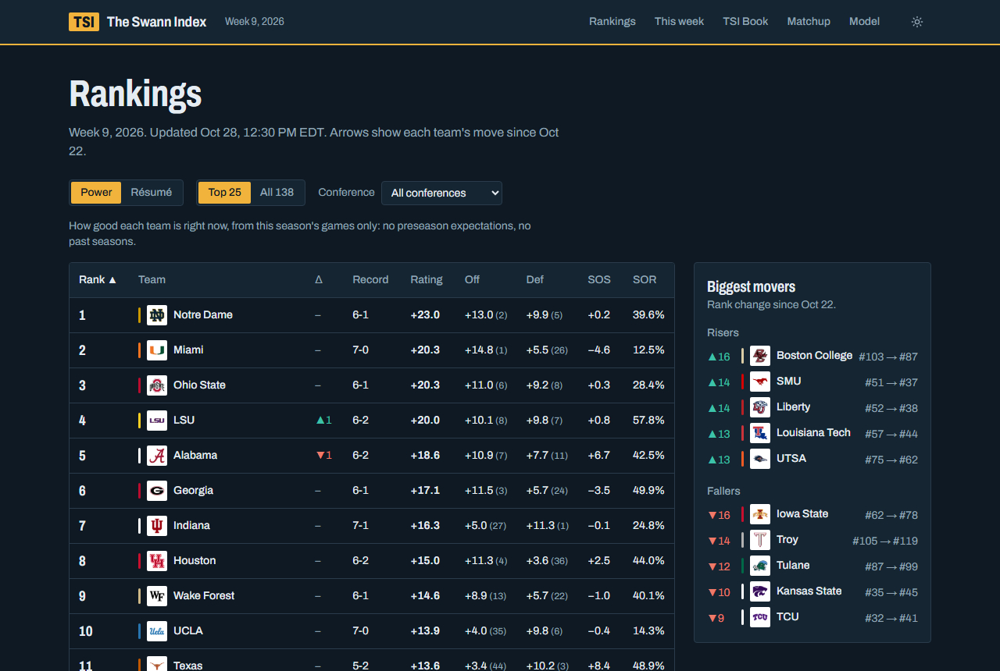
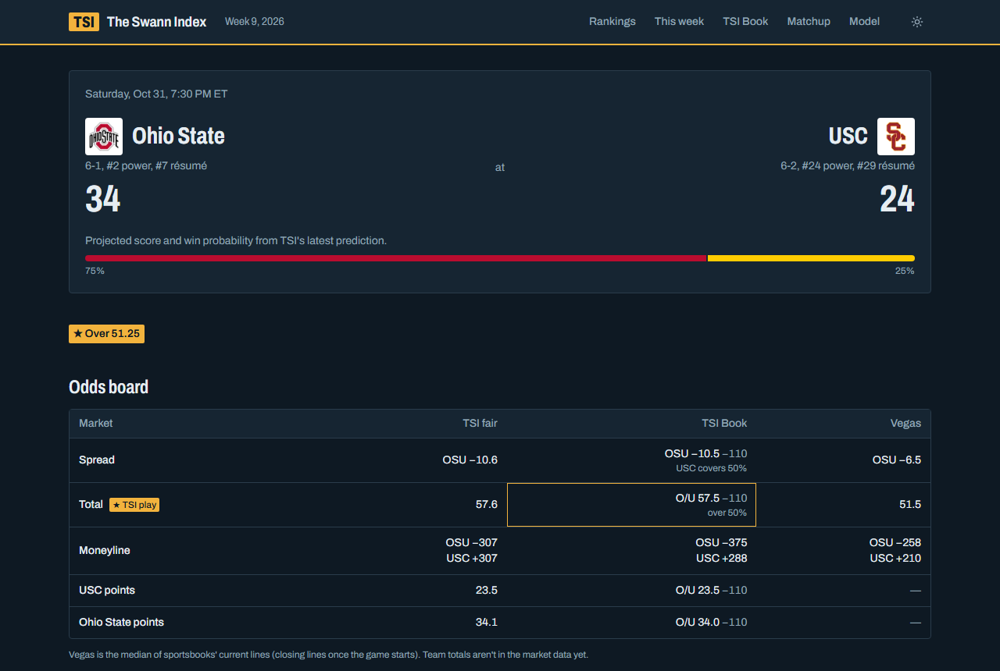
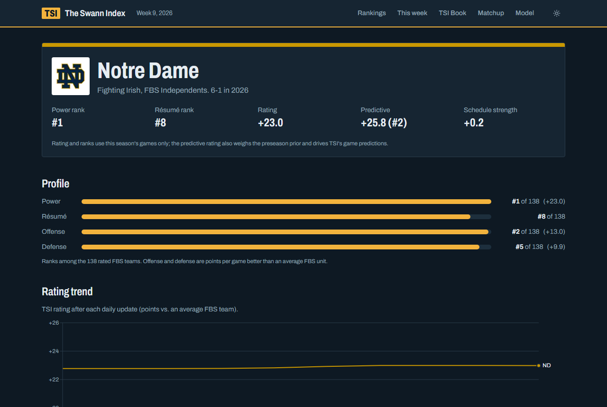
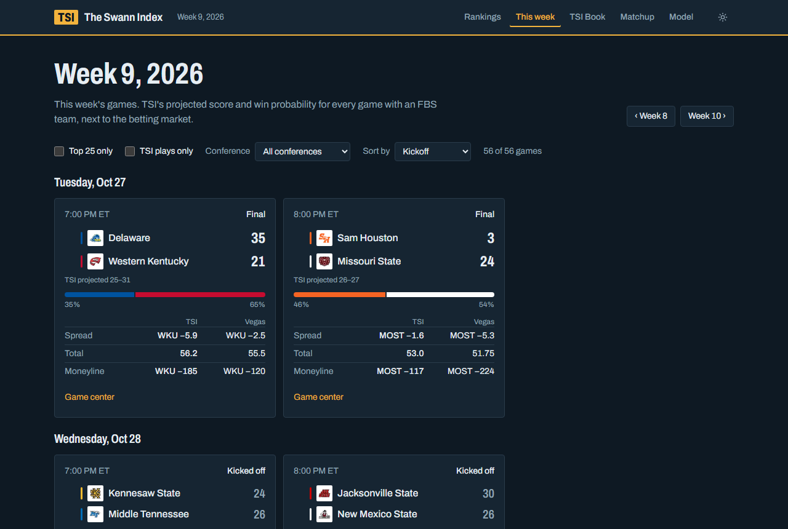
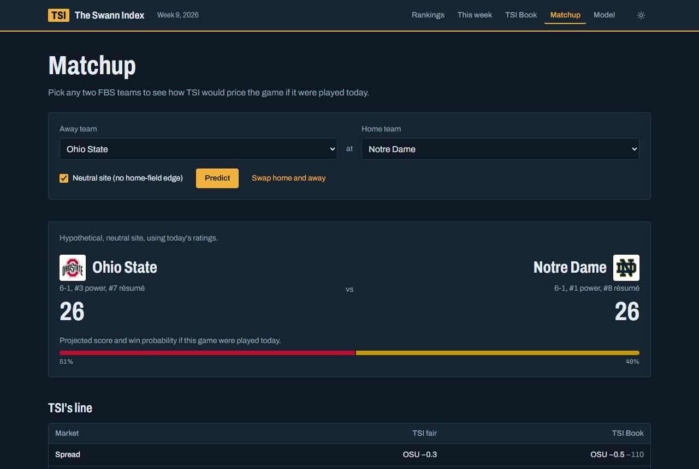
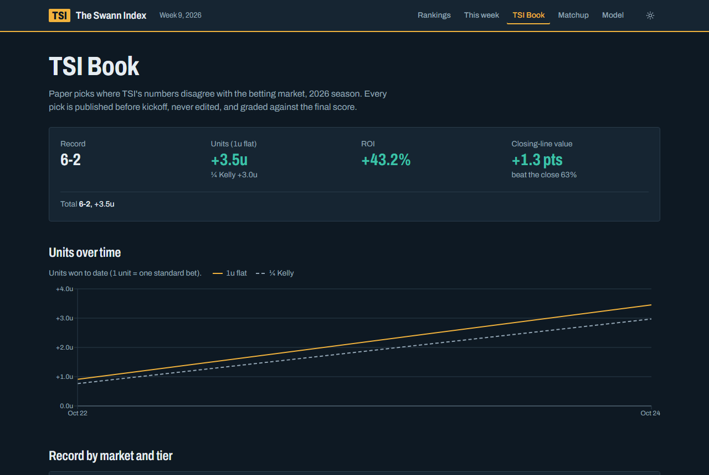
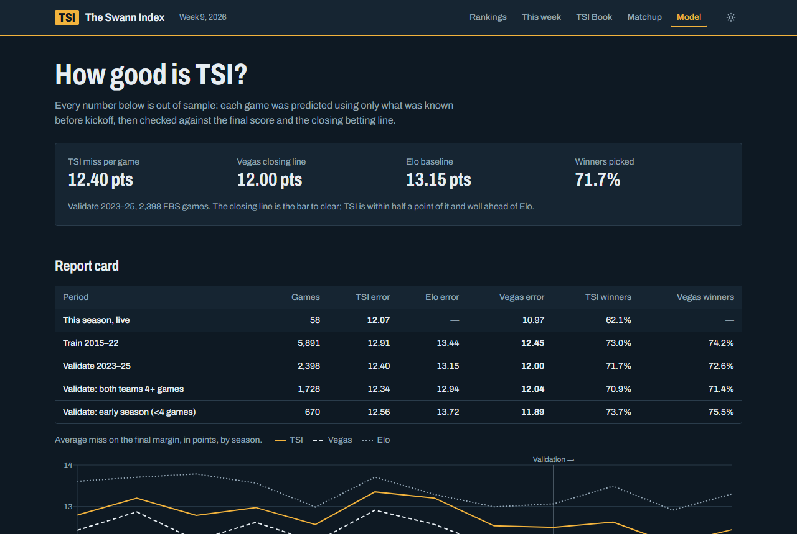
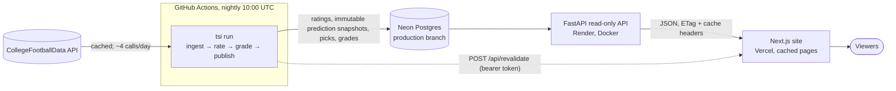

# The Swann Index (TSI)

A college football rating model and prediction engine with a read-only website.

**Live site: https://the-swann-index.vercel.app**

TSI rates every FBS team from opponent-adjusted efficiency data and turns those ratings into a full sportsbook-style board for every game: projected scores, spreads, totals, moneylines, win probabilities and edges against the betting market. Every prediction is timestamped before kickoff, never edited, and graded afterwards, so the track record is public.



## How good is it?

Every number is out of sample: each game was predicted using only what was known before kickoff (walk-forward, refit daily like the live model).

| Validation 2023–25 (2,398 FBS games) | TSI | Vegas closing line | Elo baseline |
|---|---|---|---|
| Average miss on the final margin | **12.40 pts** | 12.00 pts | 13.15 pts |
| Winners picked | **71.7%** | 72.6% | n/a |

The closing line is the bar to clear, and TSI sits within half a point of it. Its spread disagreements with the close don't predict covers, but they do predict which way the line moves, and its totals beat the **opening** line: the TSI Book's backtest at the median opener went **104-75-2 (+10.8% ROI)** over 2023–25, with positive closing-line value every season. The details are in [the model doc](docs/04-model.md) and [the Book doc](docs/05-sportsbook.md).

## What's on the site

| | |
|---|---|
|  **Game center:** projected score, win probability, TSI's fair line and Book prices next to Vegas, alt-line ladder and score distribution. |  **Team pages:** Power and Résumé ranks, offense/defense profile, rating trend, schedule with win odds and a Résumé breakdown. |
|  **This week:** every game with TSI's numbers beside the market, filterable by Top 25, conference and TSI plays. |  **Matchup:** price any two FBS teams as if they played today, home or neutral site. |
|  **TSI Book:** paper picks published before kickoff and graded afterwards: record, units, ROI and closing-line value. |  **Model:** the report card. Backtest error by season against Vegas and Elo, calibration and methodology. |

- **Power** ranks who is best right now, from this season's games only.
- **Résumé** ranks who has earned it: how likely a typical #12 team would be to match the record against the same schedule.

## Architecture



- **Python owns all the data and math.** The site never calculates odds or ratings; it renders what the API returns. The one on-demand calculation is the matchup tool's endpoint.
- **No look-ahead.** Any rating, prediction or backtest for a game uses only data available before its kickoff.
- **Published predictions are immutable.** New forecasts are new snapshots (a database trigger rejects updates). Only the last one published before kickoff is graded.
- **Market lines are never model inputs.** They are evaluation points, and in the Book they only size edges.
- After the nightly run, the job tells the site to refresh its cached pages and then warms the main ones.

More detail: [docs/02-architecture.md](docs/02-architecture.md) (repo layout, schema, data flow, API contract). The API spec is [docs/api/openapi.json](docs/api/openapi.json).

## Stack

| Layer | Tech |
|---|---|
| Model and data pipeline | Python 3.12 (uv), pandas, NumPy, SciPy, scikit-learn, Typer CLI (`tsi`) |
| API | FastAPI, served from Docker on Render |
| Database | PostgreSQL on Neon, SQLAlchemy 2 + Alembic |
| Website | Next.js 16 (App Router, Cache Components), React, TypeScript, Tailwind CSS 4, Recharts, TanStack Table |
| Automation | GitHub Actions: CI on every push (gates API deploys) and the nightly `tsi run` |
| Hosting | Vercel (site), Render (API), Neon (database) |
| Data | [CollegeFootballData.com](https://collegefootballdata.com) API |

## Running it locally

You need Python 3.12 with [uv](https://docs.astral.sh/uv/), Node 24, a Postgres database and a free CFBD API key. Secrets live only in gitignored env files: copy `backend/.env.example` to `backend/.env` and `web/.env.example` to `web/.env.local`, then fill them in.

```powershell
# Backend (from backend/)
uv sync
uv run alembic upgrade head
uv run tsi ingest season --season 2014 --through 2026   # first load (~9 API calls per season)
uv run tsi run                                          # ingest -> rate -> grade -> publish
uv run tsi serve                                        # API at http://127.0.0.1:8000 (docs at /docs)
uv run pytest -m "not db"                               # offline tests

# Website (from web/, with the API running)
npm install
npm run dev                                             # http://localhost:3000
npm run check                                           # API types, typecheck, lint, formatting
```

[docs/08-setup-windows.md](docs/08-setup-windows.md) walks through the full setup. [CLAUDE.md](CLAUDE.md) lists every command.

## Documentation

| Doc | Contents |
|---|---|
| [01 – Vision](docs/01-vision.md) | What TSI is, goals, non-goals, success criteria |
| [02 – Architecture](docs/02-architecture.md) | System design, repo layout, data flow, API, hosting |
| [03 – Data Sources](docs/03-data-sources.md) | CFBD endpoints, ingestion and caching rules |
| [04 – Model](docs/04-model.md) | Rating methodology, priors, backtesting |
| [05 – Prediction Engine & Book](docs/05-sportsbook.md) | Score distributions, odds, market edges, picks ledger |
| [06 – Frontend](docs/06-frontend.md) | Pages, components, visuals, design direction |
| [07 – Roadmap](docs/07-roadmap.md) | Phased build plan with checklists |
| [08 – Windows Setup](docs/08-setup-windows.md) | Environment setup |
| [09 – Conventions](docs/09-conventions.md) | Workflow, modularity, secrets, skills |
| [Decisions](docs/decisions.md) | Decision log |

---

*TSI is a statistical model built for analysis and entertainment. It does not take or place wagers.*
